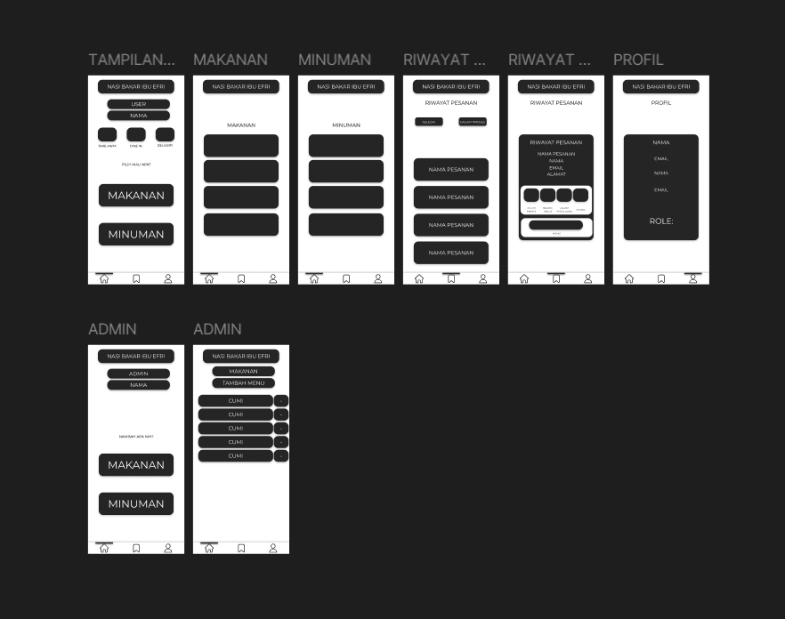

- Menentukan Tema Project
  Sistem Layanan Pemesanan Nasi Bakar Berbasis Mobile untuk Wilayah Kota Cirebon
- Pembagian tugas
    Admin : Rizki
    Delivery : Nurkhotimah
    User : Hilal Dan Pasya
- ss minimal Sketch up > sudah ada halamannya

1. Rizki Aidil Fazri = Halaman Admin

2. Nurkhotimah = 

3. Pasya & Hilal = Halaman Pelanggan (User)

### Rancangan Antarmuka

